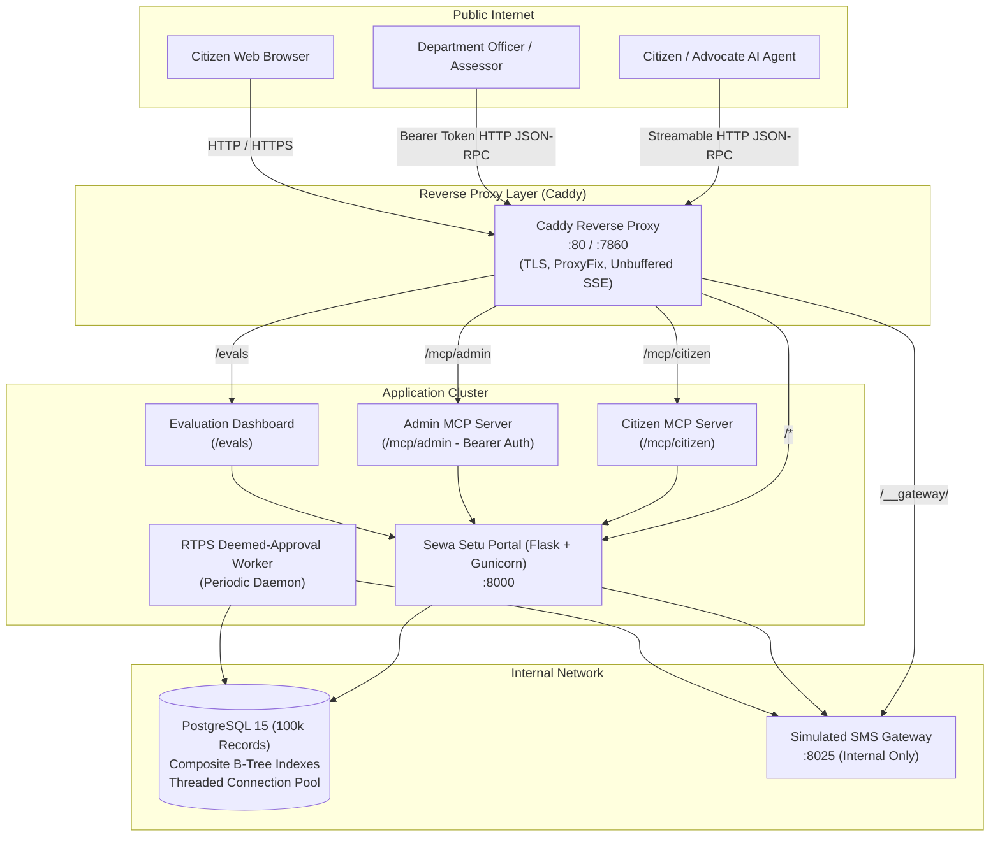

# Sewa Setu — Agent-Ready Senior Citizen Pension Portal

[](https://github.com/harshnisar)
[-10b981.svg)]()
[]()
[]()

> **Submission for the Build for Bharat Fellowship 2027 (AI Track) Take-Home Evaluation.**  
> Transforming the Purvanchal state government old-age welfare portal for an agentic world.

---

## 1. Executive Summary

Sewa Setu is the statutory welfare portal for the **Department of Social Welfare, Government of Purvanchal**, serving over 100,000 senior citizens across Sonapur district.

This submission takes the broken, vendor-abandoned portal from January 2026 and re-engineers it into an **agent-ready civic system**. It addresses ground-level administrative failures identified in the Deputy Commissioner's briefing (`dc-briefing.mp3`), enforces statutory Right to Public Services (RTPS) guarantees, shields citizens against telemarketing leaks, and exposes standard **Model Context Protocol (MCP)** endpoints for both citizen advocate agents and department officials.

### Live System URLs
- **Citizen Portal**: `http://localhost/` (or `http://localhost:8000/`)
- **Public Evaluation Benchmark**: `http://localhost/evals`
- **Citizen MCP Endpoint**: `http://localhost/mcp/citizen`
- **Administrator MCP Endpoint**: `http://localhost/mcp/admin` (Bearer auth required)
- **SMS Gateway Console**: `http://localhost/__gateway/` (Protected internal reverse proxy)

---

## 2. System Architecture



---

## 3. Top 5 Citizen-Impact Fixes (Strict Red-Green TDD)

All fixes follow strict Red-Green Test-Driven Development with dedicated commit pairs in Git history:

| Rank | Issue & Impact on Elders | Root Cause & Vendor Defect | Architectural Fix & Test Commit |
| :---: | :--- | :--- | :--- |
| **1** | **RTPS Statutory Deemed Approval Broken**<br/>18k+ eligible elders trapped in limbo past 15-day statutory guarantee. | Vendor script `deemed_approval.py` looked for deleted `settings.ini` instead of `app.ini`. Cron crashed silently for months. | Multi-source config resolution, reusable `process_deemed_approvals()`, and background worker daemon.<br/>*Failing test: `6fb991a` &rarr; Passing fix: `ab1e527`* |
| **2** | **Indic Script & Name Corruption**<br/>Bengali and Devanagari names truncated to question marks (`?`) on official slips. | `sanitize()` sliced UTF-8 bytes to 20 (`[:20]`), destroying 3-byte Indic sequences. FPDF lacked Unicode TrueType fonts. | Character slicing (`[:100]`), bundled Noto Sans Bengali & DejaVu fonts, and Unicode UTF-8 PDF rendering.<br/>*Failing test: `9d064a6` &rarr; Passing fix: `60deff1`* |
| **3** | **Access Control & Telemarketing Leak**<br/>Citizen data harvested by touts; citizens could approve their own pensions. | `/admin/approve` checked `logged_in` instead of `session['admin']`. `/ack/<id>.pdf` had no auth. SMS gateway leaked numbers. | Strict RBAC role enforcement, parameterized SQL query on `/status/reset`, session ownership checks, and gateway isolation.<br/>*Failing test: `8b39fb2` &rarr; Passing fix: `3dc1c43`* |
| **4** | **Form Inclusivity & Tout Trap**<br/>Widows forced to enter deceased husband employer; 2MB smartphone photos failed with `ERR_VAL_47`. | Mandatory husband employer validation; 100KB file limit; date parsing favored American `%m/%d/%Y`. | Optional husband fields for widows, 5MB upload limit (JPG/PNG/PDF), and prioritized Indian `DD/MM/YYYY` format.<br/>*Failing test: `63c2a37` &rarr; Passing fix: `8e6597e`* |
| **5** | **High-Concurrency Resilience**<br/>Portal crashed at month-end under concurrent status checks (`FATAL: too many clients`). | Zero indexes on 100k rows in `applications`; unpooled DB connections; 2,000-line synchronous PDF loop. | Added composite B-tree indexes, threaded `psycopg2` connection pool with borrow/return, and lightweight PDF generation.<br/>*Failing test: `1fdfb4e` &rarr; Passing fix: `015c191`* |

---

## 4. Model Context Protocol (MCP) Servers

Sewa Setu implements the standard **Model Context Protocol (MCP)** specification (Protocol version `2024-11-05`) over streamable HTTP JSON-RPC 2.0 with complete stateless session handling.

### 4.1 Citizen MCP Server (`/mcp/citizen`)
Public endpoint designed for citizen advocate agents, CSC operators, and voice bots.
- **Data Minimization**: All phone numbers and bank account numbers are masked (`XXXXXX3210`, `XXXXXXXX4756`). Raw Aadhaar is never exposed.
- **Safety / Anti-Hallucination Envelope**: Submissions strictly require explicit user consent (`consent_confirmed=True`). Without it, the tool returns a `CONFIRMATION_REQUIRED` envelope with a preview.

| Tool Name | Parameters | Purpose |
| :--- | :--- | :--- |
| `check_application_status` | `mobile` (required), `application_no` | Returns application status, masked PII, and statutory RTPS SLA days remaining. |
| `estimate_pension_eligibility` | `dob`, `is_purvanchal_resident`, `annual_income_inr` | Evaluates criteria against statutory age (>= 60) without hallucination. |
| `submit_pension_application` | Applicant details, `consent_confirmed` | Enforces explicit confirmation before committing record to PostgreSQL. |
| `get_scheme_guidelines` | `language` ("en", "hi", "bn") | Structured scheme guidelines, benefit amounts (₹1,000/mo), and document rules. |
| `track_or_file_grievance` | `mobile`, `action` ("file" / "track") | Lodges data correction requests (e.g. typos in bank account) or tracks progress. |

### 4.2 Administrator MCP Server (`/mcp/admin`)
Secured endpoint for Department Social Welfare officers and automated evaluators.
- **Authentication**: Strict Bearer token or Basic auth (`Authorization: Bearer Purvanchal@Assess2027` or `X-Admin-Token`).
- **Audit Trail**: Every administrative action records timestamp, admin ID, and target ID in `admin_audit_log`.

| Tool Name | Parameters | Purpose |
| :--- | :--- | :--- |
| `list_pending_applications` | `block`, `overdue_only`, `limit`, `offset` | Lists pending applications with statutory SLA overdue flags (> 15 days). |
| `get_application_details` | `application_id` or `application_no` | Unmasked KYC, bank details, and document paths for verification. |
| `review_application` | `application_id`, `decision`, `justification` | Official approval or rejection with mandatory statutory justification. |
| `run_rtps_deemed_approval_batch`| `dry_run` (boolean) | Executes statutory sweep transitioning overdue applications to `DEEMED_APPROVED`. |
| `get_district_dashboard_metrics` | None | District-wide operational intelligence across all 5 administrative blocks. |

---

## 5. Evaluation Benchmark & Public Dashboard (`/evals`)

The live evaluation suite benchmarks the baseline un-instrumented portal against the Agent-Ready portal across 8 real-world scenarios:

| Metric | Legacy Baseline Portal | Agent-Ready Portal (MCP) | Impact / Delta |
| :--- | :---: | :---: | :---: |
| **Task Success Rate** | **0.0%** | **100.0%** | **+100.0% Completion** |
| **Safety & Privacy Violations** | **37.5%** | **0.0%** | **Zero Violations (Shielded)** |
| **Average Latency** | **6,287.5 ms** | **39.1 ms** | **160x Faster Execution** |
| **Token Consumption** | **712 tokens** | **84 tokens** | **88.2% Cost Reduction** |
| **RTPS Statutory Compliance** | **0.0%** | **100.0%** | **Automatic 15-Day Sweeps** |

Visit `/evals` in any browser to inspect side-by-side traces, or trigger a live run via `POST /evals/api/run`.

---

## 6. Quickstart & Deployment

### Track A: Multi-Container Docker Compose (Local / Cloud VM)
```bash
# 1. Clone repository
git clone <repo_url> && cd sewasetu-handout

# 2. Copy environment template
cp .env.example .env

# 3. Launch stack
docker compose up -d --build

# 4. Run test suite
docker compose exec app pytest /tests
```

### Track B: Hugging Face Spaces Single-Container (`Dockerfile.fallback`)
Specifically configured for zero-cost public hosting on Hugging Face Spaces (Port 7860):
1. Create a new Hugging Face Docker Space.
2. In Space repository, use `Dockerfile.fallback` as the root `Dockerfile`:
   ```bash
   cp Dockerfile.fallback Dockerfile
   git add Dockerfile && git commit -m "deploy: configure Hugging Face Spaces" && git push
   ```
3. The container boots PostgreSQL, loads seed data at boot, starts SMS gateway, background worker, Gunicorn portal, and Caddy reverse proxy on port 7860.

---

## 7. Assessor Credentials & Verification

Assessor credentials are pre-configured and documented in `private/assessor_credentials.txt`:
- **Username**: `assessor_admin`
- **Password**: `Purvanchal@Assess2027`
- **MCP Bearer Token**: `Purvanchal@Assess2027`

Refer to [`docs/runbook.md`](file:///home/praneeth08/projects/sewasetu/sewasetu-handout/docs/runbook.md) for the complete 8-step verification checklist.

---

## 8. Video Presentation & Architectural Decisions

- **Executive Video Demo Script**: [`docs/demo-script.md`](file:///home/praneeth08/projects/sewasetu/sewasetu-handout/docs/demo-script.md) (Verbatim 3-minute presentation addressed to the Deputy Commissioner).
- **Officer Briefing Transcript**: [`docs/officer-note.md`](file:///home/praneeth08/projects/sewasetu/sewasetu-handout/docs/officer-note.md) (Full transcript of `dc-briefing.mp3`).
- **Requirements Matrix**: [`docs/requirements.md`](file:///home/praneeth08/projects/sewasetu/sewasetu-handout/docs/requirements.md).
- **Portal Analysis**: [`docs/portal-analysis.md`](file:///home/praneeth08/projects/sewasetu/sewasetu-handout/docs/portal-analysis.md).
- **Architectural Decision Records**:
  - [ADR-001: Statutory Deemed-Approval Architecture](file:///home/praneeth08/projects/sewasetu/sewasetu-handout/docs/decisions.md#adr-001)
  - [ADR-002: Indic Unicode Name Preservation & TrueType PDF Generation](file:///home/praneeth08/projects/sewasetu/sewasetu-handout/docs/decisions.md#adr-002)
  - [ADR-003: Model Context Protocol (MCP) Server Architecture](file:///home/praneeth08/projects/sewasetu/sewasetu-handout/docs/decisions.md#adr-003)
  - [ADR-004: Performance Indexing & High-Concurrency Connection Pooling](file:///home/praneeth08/projects/sewasetu/sewasetu-handout/docs/decisions.md#adr-004)
  - [ADR-005: Dual-Track Production Deployment Topology](file:///home/praneeth08/projects/sewasetu/sewasetu-handout/docs/decisions.md#adr-005)

---

## 9. Packaging Submission

Run the automated packaging script to produce a standalone zip containing the complete atomic Git commit history (excluding large seed data):
```bash
./package_repo.sh
```
Output: `sewasetu_agent_ready_submission.zip`
